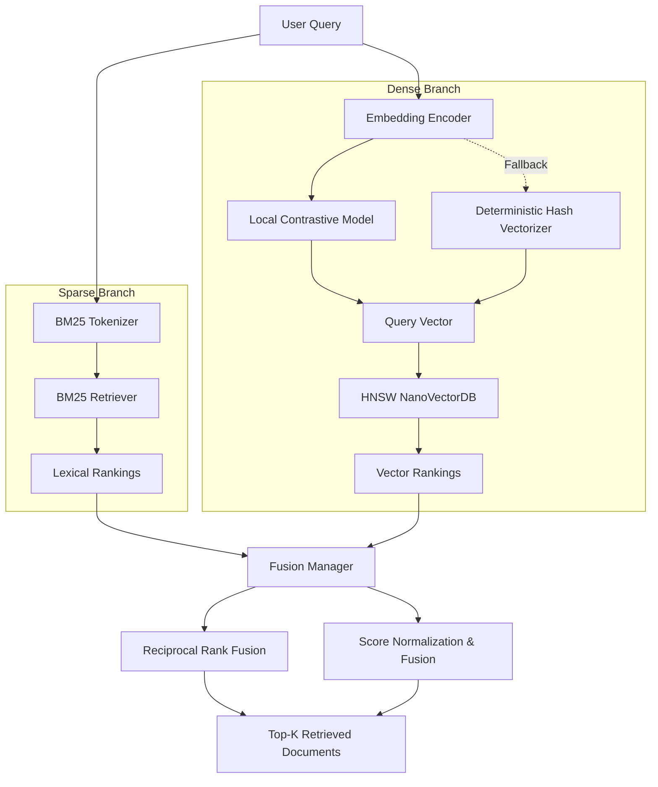

# hybrid-search-retrieval-pipeline

Hybrid retrieval pipeline that combines classic lexical search (Okapi BM25) and semantic vector search (NanoVectorDB) using advanced ranking fusion algorithms (RRF and Score Normalization).

This module is a core piece in production Retrieval-Augmented Generation (RAG) architectures, solving the limitation of searching only by semantic similarity (which tends to ignore error codes, acronyms, serial numbers, or product IDs) or searching only by keywords (which lacks contextual understanding and synonymy).

## Architecture and Theoretical Foundations

The pipeline implements a two-way parallel search strategy (Dense + Sparse) and consolidates its results through ranking alignment techniques.



### 1. Sparse Search (Okapi BM25)

The `BM25Retriever` module implements the unweighted Okapi BM25 algorithm over a locally indexed static corpus. The score of a document $D$ with respect to a query $Q$ composed of terms $q_1, q_2, \dots, q_n$ is formally defined as:

$$\text{score}(D, Q) = \sum_{i=1}^{n} \text{IDF}(q_i) \cdot \frac{f(q_i, D) \cdot (k_1 + 1)}{f(q_i, D) + k_1 \cdot \left(1 - b + b \cdot \frac{|D|}{\text{avgdl}}\right)}$$

Where:
*   $f(q_i, D)$ represents the absolute frequency of term $q_i$ in document $D$.
*   $|D|$ is the length in tokens of the analyzed document.
*   $\text{avgdl}$ is the average length of all documents within the indexed corpus.
*   $k_1$ is the term saturation parameter (defaults to `1.5`), which limits the influence of the non-linear growth of the same term's frequency.
*   $b$ is the document length normalization coefficient (defaults to `0.75`), penalizing excessively long documents if they don't add relevant information.

The inverse document frequency ($\text{IDF}$) calculation applies smoothing to prevent indeterminate or negative values for terms that are excessively common in the corpus:

$$\text{IDF}(q_i) = \ln\left(1.0 + \frac{N - df(q_i) + 0.5}{df(q_i) + 0.5}\right)$$

Where $N$ is the corpus size and $df(q_i)$ is the number of documents containing at least one occurrence of term $q_i$. If a term produces a theoretically negative IDF, a floor of `0.0001` is applied to ensure the ranking's numerical stability.

The pipeline preprocesses the query and corpus by applying tokenization that lowercases the text, extracts words via the word-level regular expression `\b\w+\b`, and removes stop-words from a built-in Spanish and English list to mitigate statistical noise.

### 2. Reciprocal Rank Fusion (RRF)

RRF is an empirical ranking fusion method based on the relative order of items rather than the absolute magnitude of their scores. It allows combining different probability distributions and metric distances without requiring calibration or scale adjustment:

$$\text{RRF\_score}(d) = \sum_{m \in M} \frac{1}{k + r_m(d)}$$

Where:
*   $M$ is the set of retrievers (in this case, Sparse and Dense).
*   $r_m(d)$ is the position (rank) of document $d$ in the list returned by retriever $m$ (1-indexed). If a document doesn't appear in a retriever's ranking, its rank is treated as infinite ($\frac{1}{\infty} = 0$).
*   $k$ is a smoothing constant (defaults to `60`), responsible for reducing the disproportionate influence of the top ranking positions and stabilizing the fusion against minor variations in lower positions.

### 3. Weighted Linear Fusion (Score Normalization Fusion)

When the source scores are needed for further analysis, this method converts the dense search distances and BM25 scores to a normalized $[0, 1]$ range using the Min-Max technique:

$$\text{Score}_{\text{norm}} = \frac{\text{Score} - \text{Score}_{\text{min}}}{\text{Score}_{\text{max}} - \text{Score}_{\text{min}}}$$

Beforehand, the distances returned by `NanoVectorDB` (which depend on the configured metric) are projected onto similarity indices:
*   **Cosine Similarity:** Assumes $\text{Similarity} = 1.0 - \text{cosine\_distance}$.
*   **Euclidean Similarity (L2):** Transformed via the monotonic function $\text{Similarity} = \frac{1.0}{1.0 + \text{L2\_distance}}$.
*   **Dot Product Similarity:** Since `NanoVectorDB` stores the negative of the dot product to minimize it as a distance, $\text{Similarity} = -\text{dot\_distance}$ is applied.

Once the normalized similarities for both branches are obtained, the combined score is calculated via a parameterizable weighting:

$$\text{Score}_{\text{final}}(d) = \alpha \cdot \text{Score}_{\text{norm\_dense}}(d) + (1.0 - \alpha) \cdot \text{Score}_{\text{norm\_sparse}}(d)$$

Where $\alpha \in [0, 1]$ is the dense weighting coefficient (defaults to `0.5`).

## Connection to the Ecosystem

This module acts as an orchestrator that connects the following subprojects:
1.  **nano-vector-db:** Retrieves dense vector candidates through multi-layer HNSW graph searches. The pipeline passes it query vectors and optional metadata filters, extracting the documents' distances and IDs.
2.  **contrastive-embedding-trainer:** The pipeline checks whether a trained PyTorch/Transformers model exists at the relative path `../contrastive-embedding-trainer/model_output`. If available, it automatically loads it into memory to encode incoming queries via *Mean Pooling* and L2 normalization techniques. If absent, it uses a deterministic pseudo-random generator based on the text string's hash to avoid interrupting the execution flow.

## File Structure

*   `bm25.py`: Contains the `BM25Retriever` class, responsible for tokenization, frequency extraction, and Okapi BM25/IDF score calculation.
*   `fusion.py`: Module with the implementations of the `reciprocal_rank_fusion` and `score_normalization_fusion` algorithms.
*   `pipeline.py`: `HybridSearchPipeline` class that unifies the retrievers and coordinates parallel search execution.
*   `test_pipeline.py`: Unit test suite that validates the behavior and accuracy of the BM25, RRF, and normalization math formulas.
*   `example.py`: Interactive demo code that illustrates the difference in results when performing pure lexical search, pure vector search, RRF, and hybrid Score Normalization search.

## Installation and Usage

### 1. Set Up the Environment and Install Dependencies

Python 3.9 or higher is required. Initialize the virtual environment and ensure the required dependencies are present:

```bash
python3 -m venv .venv
source .venv/bin/activate
pip install -r requirements.txt
```

### 2. Run the Unit Tests

The test suite validates the mathematical correctness of the ranking fusion formulas and the coherence of BM25 search:

```bash
.venv/bin/python -m unittest test_pipeline.py
```

### 3. Run the Hybrid Search Demo

To see the pipeline in action, run:

```bash
.venv/bin/python example.py
```

The script populates a `NanoVectorDB` vector database, concurrently indexes the text corpus into the BM25 engine, generates example searches, and shows in detail the transition of scores and resulting positions under RRF and Score Normalization.
